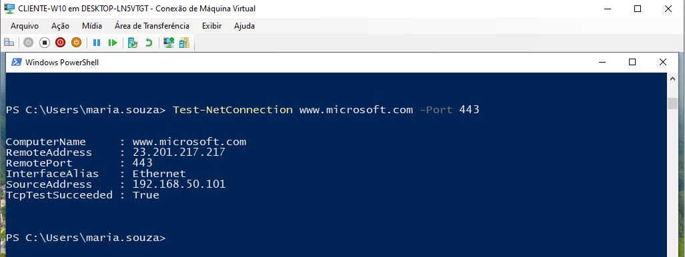

# Projeto 02 — Troubleshooting de Rede N1/N2

## Objetivo

Executar testes práticos de diagnóstico de conectividade em uma estação Windows, seguindo uma sequência de troubleshooting semelhante à utilizada em atendimentos de Help Desk N1/N2.

## Ambiente

* **Cliente:** CLIENTE-W10
* **Servidor/gateway do laboratório:** 192.168.50.10
* **Rede local:** 192.168.50.0/24
* **DNS configurado no cliente:** 192.168.50.10

## Testes executados

| Teste                                            | Resultado observado                            | Interpretação                              |
| ------------------------------------------------ | ---------------------------------------------- | ------------------------------------------ |
| `ipconfig`                                       | IPv4 `192.168.50.101`, máscara `255.255.255.0` | Configuração IP identificada               |
| `ping 192.168.50.10`                             | 4 enviados, 4 recebidos                        | Conectividade com o servidor/gateway       |
| `nslookup www.microsoft.com`                     | Vários endereços retornados                    | Resolução DNS funcionando                  |
| `tracert -d 8.8.8.8`                             | Vários saltos externos observados              | O tráfego percorreu a rede externa         |
| `ping 8.8.8.8`                                   | 4 enviados, 4 recebidos                        | Conectividade IP com o destino             |
| `Test-NetConnection www.microsoft.com -Port 443` | `TcpTestSucceeded: True`                       | Conexão TCP com a porta HTTPS estabelecida |

## Conclusão

Nos testes realizados, não foi identificada falha de conectividade IP, resolução DNS ou estabelecimento de conexão TCP com o destino HTTPS testado.

Esses resultados validam apenas os destinos e serviços testados; não garantem o funcionamento de todos os sites ou aplicações.

## Conhecimentos praticados

* Leitura de configuração IP no Windows
* Teste de conectividade com `ping`
* Diagnóstico de resolução DNS com `nslookup`
* Análise de rota com `tracert`
* Validação de porta TCP com `Test-NetConnection`
* Interpretação de resultados sem presumir uma falha não comprovada

## Evidência — teste de conectividade HTTPS

O teste abaixo valida o estabelecimento de uma conexão TCP com `www.microsoft.com` na porta 443.

## Caso prático — validação de conectividade

**Cenário:** verificar se uma estação Windows possui conectividade com a rede local e com um destino externo.

**Procedimento de diagnóstico:**
1. Verificação da configuração IP com `ipconfig`.
2. Teste de conectividade com o servidor/gateway usando `ping`.
3. Validação da resolução DNS com `nslookup`.
4. Análise do caminho de rede com `tracert`.
5. Teste de conectividade IP externa com `ping 8.8.8.8`.
6. Validação da conexão TCP HTTPS com `Test-NetConnection`.

**Resultado:** todos os testes de conectividade executados apresentaram resultados compatíveis com o funcionamento dos componentes testados.

**Conclusão técnica:** não foi reproduzida uma falha de conectividade neste cenário. Em um atendimento real, se o usuário ainda relatasse problemas, o próximo passo seria identificar o site, serviço ou aplicação afetada e reproduzir o sintoma específico.

**Classificação:** exercício de diagnóstico preventivo, sem incidente confirmado.
